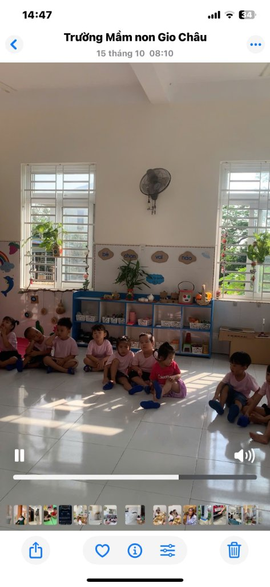
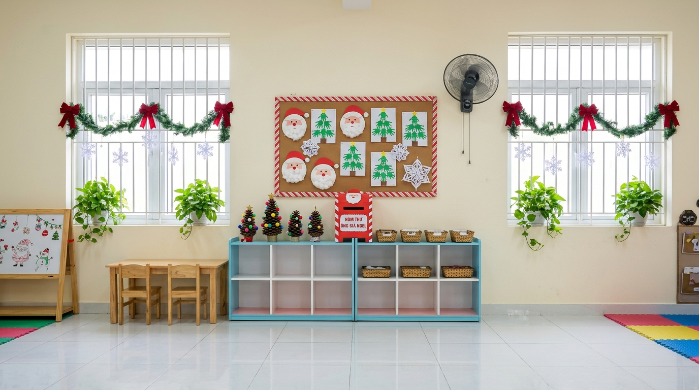
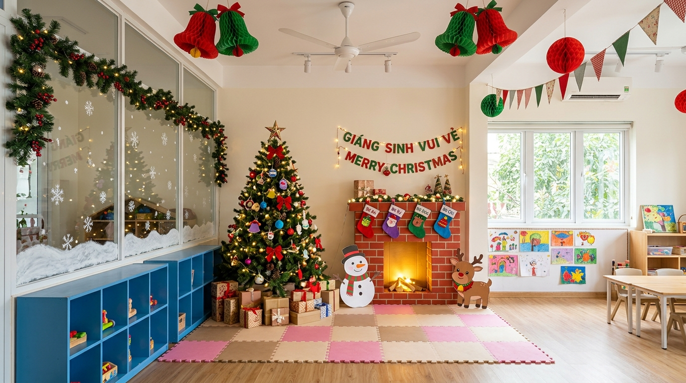

# Thiết Kế Trang Trí Lớp Học Mầm Non Chủ Đề Giáng Sinh: "Ngôi Làng Giáng Sinh Ấm Áp"

* **Đơn vị hiện trạng:** Lớp mẫu giáo 4 tuổi – Trường Mầm non Gio Châu
* **Độ tuổi trẻ:** 4 tuổi
* **Ngân sách dự kiến:** **1.950.000 VNĐ** (Trong giới hạn ngân sách 2.000.000 VNĐ)
* **Quy tắc thi công:** Giữ nguyên kết cấu phòng, không thay đổi vị trí đồ dùng cố định; sử dụng vật liệu an toàn, giá rẻ, dễ tìm và 90% có thể tái sử dụng cho các năm sau.

---

## 1. Bộ Ảnh Hiện Trạng Và Phối Cảnh 3D Sau Trang Trí (Mỗi Nội Dung 02 Ảnh)

### 📸 Cặp Ảnh Góc 1: Mảng Tường Chính, 2 Cửa Sổ & Kệ Hoạt Động

| 1. Ảnh gốc hiện trạng (Góc 1) | 2. Phối cảnh 3D sau khi trang trí (Góc 1) |
| :---: | :---: |
|  |  |
| *Mảng tường kem, 2 cửa sổ có chậu trầu bà, quạt treo tường đen, kệ xanh "Bé chọn vai nào"* | *Bảng nỉ Giáng Sinh, hòm thư ông già Noel, cây thông quả thông handmade, dây thông xanh viền cửa* |

* 👉 **Tải ảnh so sánh góc 1:** [BaiTap1_So_Sanh_Goc1.jpg](BaiTap1_So_Sanh_Goc1.jpg)

---

### 📸 Cặp Ảnh Góc 2: Toàn Cảnh Góc Lớp & Góc Check-in Lò Sưởi

| 3. Ảnh gốc hiện trạng (Góc 2) | 4. Phối cảnh 3D sau khi trang trí (Góc 2) |
| :---: | :---: |
|  |  |
| *Toàn cảnh góc phòng, vách kính hành lang, thảm xốp hồng, quạt trần, kệ đồ chơi* | *Lò sưởi thùng carton DIY, cây thông 1,5m ấm áp, người tuyết & tuần lộc giấy, bông tuyết vách kính* |

* 👉 **Tải ảnh so sánh góc 2:** [BaiTap1_So_Sanh_Goc2.jpg](BaiTap1_So_Sanh_Goc2.jpg)
* 🖼️ **Tải ảnh tổng hợp cả 4 ảnh (2x2):** [BaiTap1_Tong_Hop_4_Anh.jpg](BaiTap1_Tong_Hop_4_Anh.jpg)

---

## 2. Đề Xuất Các Vật Dụng Giữ Nguyên & Tận Dụng

1. **Hai hệ kệ gỗ viền xanh dương – lòng trắng (2 tầng, 10 ô):** Giữ nguyên vị trí; màu xanh dương tự nhiên tạo thế cân bằng hoàn hảo với màu đỏ/vàng của lễ hội Noel.
2. **Các rổ nhựa trắng, khay mây tre đan sẵn có:** Tận dụng để đựng học cụ phân vai (bánh quy gừng vải nỉ, thiệp Giáng sinh).
3. **Thảm xốp ghép màu hồng tại góc phòng:** Giữ nguyên vị trí làm nền cho góc Check-in lò sưởi và cây thông, tiết kiệm chi phí mua thảm mới.
4. **Cây xanh tự nhiên (chậu trầu bà treo cửa sổ, kệ cây 2 tầng):** Giữ nguyên tạo sắc xanh tươi mát, chỉ gắn thêm vài chiếc nơ ruy-băng đỏ nhỏ.
5. **Khung bảng nỉ "Bé chọn vai nào" & nhánh cây khô dưới cửa sổ:** Giữ nguyên khung xương; thay đổi phụ kiện trang trí theo mùa lễ hội.

---

## 3. Thiết Kế Chi Tiết Từng Khu Vực Trong Lớp

### 3.1. Khu Vực Cửa Lớp (Đón Trẻ)
* **Ý tưởng:** *"Cánh Cửa Ngôi Nhà Ông Già Noel"*
* **Thi công:** 
  * Vòm cửa đi 1 đường dây thông xanh điểm xuyết quả thông khô gắn nơ đỏ.
  * Cánh cửa treo 1 vòng nguyệt quế (ĐK 40cm), xung quanh gắn các chiếc tất vải nỉ nhỏ in ảnh và tên của từng bé trong lớp.
  * Tấm bảng chào bằng bìa carton: Hình người tuyết vẫy tay *"Chào mừng các bé đến với Lớp học Giáng Sinh"*.

### 3.2. Bảng Chính (Khu Dạy Học Trung Tâm)
* **Ý tưởng:** Viền kẹo ngọt ngào, giữ lòng bảng thông thoáng để dạy học.
* **Thi công:** 
  * Viền bảng dán chéo giấy đỏ - trắng dạng kẹo gậy (Candy Cane).
  * Hai góc trên gắn chùm lá thông 3D và chuông vàng kim tuyến.
  * **Lịch đếm ngược Advent Calendar 4 tuổi:** 24 túi giấy kraft nhỏ đánh số 1–24 chứa các câu đố vui và nhiệm vụ yêu thương mỗi ngày.

### 3.3. Các Mảng Tường & Cửa Sổ
* **Mảng tường gạch men thấp (< 1,2m):** Dán decal tĩnh điện hình cây thông vải nỉ và bông tuyết (dễ bóc sạch sau lễ hội).
* **Vách kính hành lang:** Viền dây thông xanh mềm mại, thả dây cước treo bông tuyết cắt giấy trắng lơ lửng như tuyết rơi.
* **Hai cửa sổ song sắt:** Giữ luồng nắng tự nhiên; viền khung bằng dây thông xanh mỏng và quả thông khô tự nhiên.

### 3.4. Góc Check-in / Chụp Ảnh (Tại Góc Thảm Xốp Hồng)
* **Lò sưởi giả cổ bằng thùng carton:** Ghép từ các thùng mì tôm/sữa cũ, dán giấy đỏ kẻ viền gạch trắng, bên trong đặt dây đèn LED đom đóm chạy pin giả lửa bập bùng.
* **Cây thông Noel 1,5m:** Đặt cạnh lò sưởi, trang trí nơ đỏ vải dạ, quả thông khô, đèn LED vàng ấm an toàn.
* **Dưới chân cây thông:** Các hộp carton bọc giấy kraft làm hộp quà, kèm mô hình Người tuyết và Tuần lộc cắt từ bìa cứng.

### 3.5. Góc Trưng Bày Sản Phẩm Của Bé
* **Vị trí:** Mặt kệ xanh dưới vách kính thông phòng.
* **Trưng bày:** "Triển lãm mùa đông của bé" – các sản phẩm tạo hình do chính tay trẻ 4 tuổi tự làm:
  * Ông già Noel từ đĩa giấy tròn dán bông gòn làm râu.
  * Cây thông mini từ quả thông khô quét màu xanh chấm hạt xốp màu.

### 3.6. Các Góc Hoạt Động Phù Hợp Trẻ 4 Tuổi
1. **Góc Phân Vai: "Tiệm Bánh & Bưu Điện Giáng Sinh"**
   * *Bưu điện:* "Hòm thư Ông Già Noel" bằng bìa carton màu đỏ để trẻ gửi thư và đóng vai bưu tá nhí.
   * *Tiệm bánh:* Bánh quy gừng vải nỉ, bánh cupcake đất nặn an toàn.
2. **Góc Tạo Hình / Nghệ Thuật:** Chuẩn bị bông gòn, đĩa giấy, que kem gỗ, giấy màu để rèn luyện kỹ năng dán, xâu chuỗi hạt, chấm màu.
3. **Góc Toán & Khám Phá:** Đếm số quả bông gắn lên cây thông theo chữ số 1–5; phân loại màu sắc Đỏ – Xanh – Vàng.

### 3.7. Trang Trí Treo An Toàn Tuyệt Đối
* **Nguyên tắc an toàn:** Tuyệt đối không treo dây kim tuyến hay bóng bay trước lồng quạt treo tường hoặc gần quạt trần.
* **Thi công:** Treo 01 dây cờ đuôi nheo bunting giấy và 4 quả cầu giấy tổ ong (honeycomb) áp sát vào mảng tường dưới lồng quạt 40cm, cố định chắc chắn.

---

## 4. Dự Toán Ngân Sách Chi Tiết (Tổng: 1.950.000 VNĐ)

| STT | Hạng mục vật tư | Số lượng | Đơn giá (VNĐ) | Thành tiền (VNĐ) | Ghi chú & Khả năng tái sử dụng |
| :---: | :--- | :---: | :---: | :---: | :--- |
| 1 | **Cây thông Noel PVC cao 1,5m** (chân sắt) | 01 cây | 420.000 | **420.000** | Tái sử dụng 5–7 năm; an toàn cho trẻ 4 tuổi. |
| 2 | **Dây thông xanh bản dày (2m/dây)** | 05 dây | 35.000 | **175.000** | Viền cửa sổ, lò sưởi, cửa chính. |
| 3 | **Vòng nguyệt quế treo cửa (ĐK 40cm)** | 01 chiếc | 120.000 | **120.000** | Gắn thẻ tên các bé trong lớp. |
| 4 | **Đèn LED đom đóm vàng ấm dùng pin AA** | 04 bộ | 35.000 | **140.000** | Dùng pin, an toàn tuyệt đối, không giật điện. |
| 5 | **Combo phụ kiện an toàn (nơ đỏ, quả thông khô, chuông xốp)** | 01 gói lớn | 220.000 | **220.000** | Không dùng đồ thủy tinh vỡ sắc nhọn. |
| 6 | **Vải nỉ/dạ nhiều màu (Đỏ, Xanh, Trắng, Nâu)** | 15 tấm & 2m khổ lớn | — | **180.000** | Làm tất lò sưởi, bánh quy gừng góc phân vai. |
| 7 | **Bìa carton, giấy kraft, đĩa giấy, bông gòn** | 01 combo | 160.000 | **160.000** | Làm lò sưởi, hộp quà, hoạt động tạo hình của bé. |
| 8 | **Decal tĩnh điện bông tuyết & dây cờ treo** | 01 combo | 110.000 | **110.000** | Bóc dán không để lại vết keo bẩn trên kính/gạch. |
| 9 | **Băng dính 2 mặt, súng bắn keo, keo nến, kẹp gỗ** | 01 bộ | 95.000 | **95.000** | Vật tư thi công cơ bản. |
| 10 | **Hộp thư bìa carton & phụ kiện góc phân vai** | 01 bộ | 110.000 | **110.000** | Đạo cụ học tập đóng vai bưu tá nhí. |
| 11 | **Dự phòng phát sinh** | — | — | **220.000** | Bổ sung học cụ phát sinh. |
| **TỔNG** | **DỰ TOÁN TOÀN BỘ CÔNG TRÌNH** | | | **1.950.000 VNĐ** | *(Nằm trong ngân sách 2.000.000 VNĐ)* |
